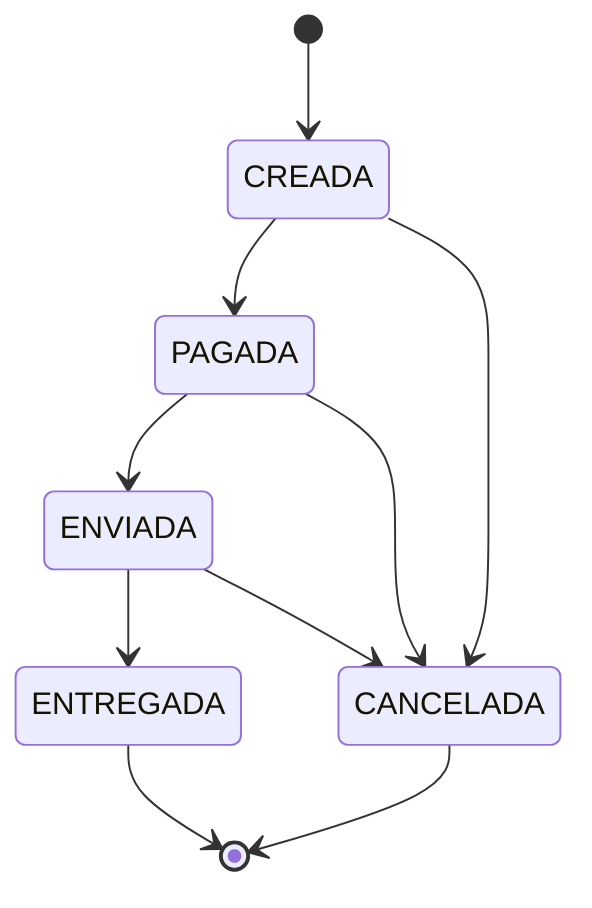
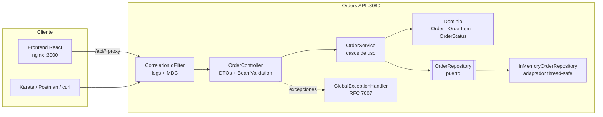
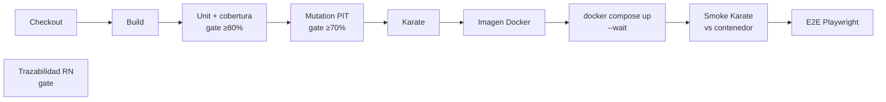
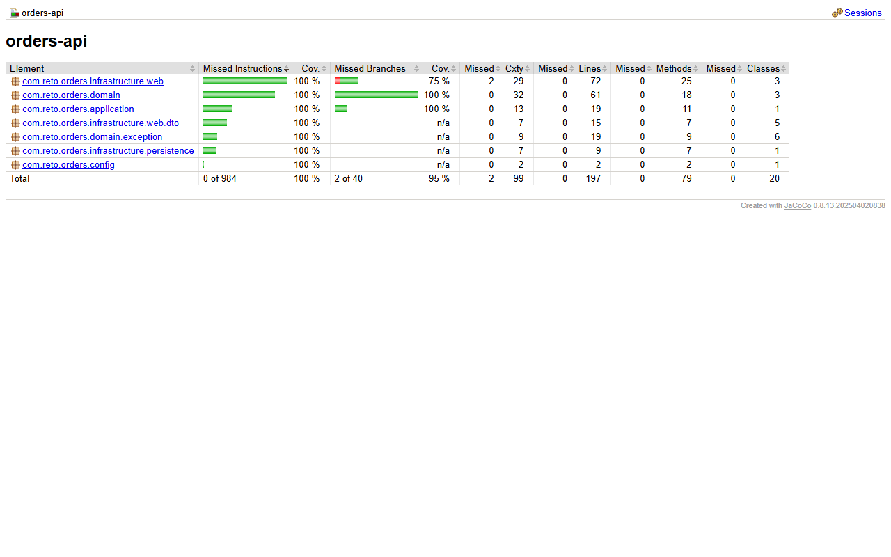
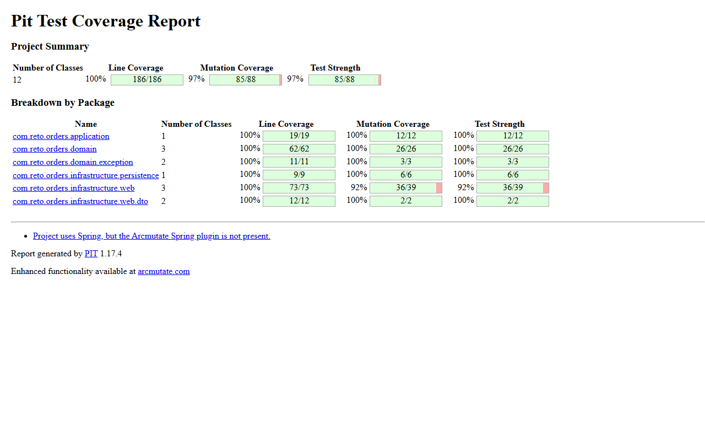
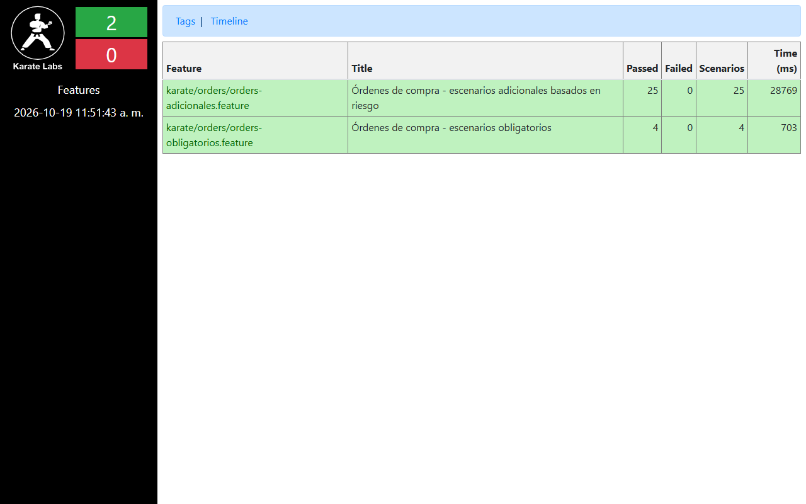
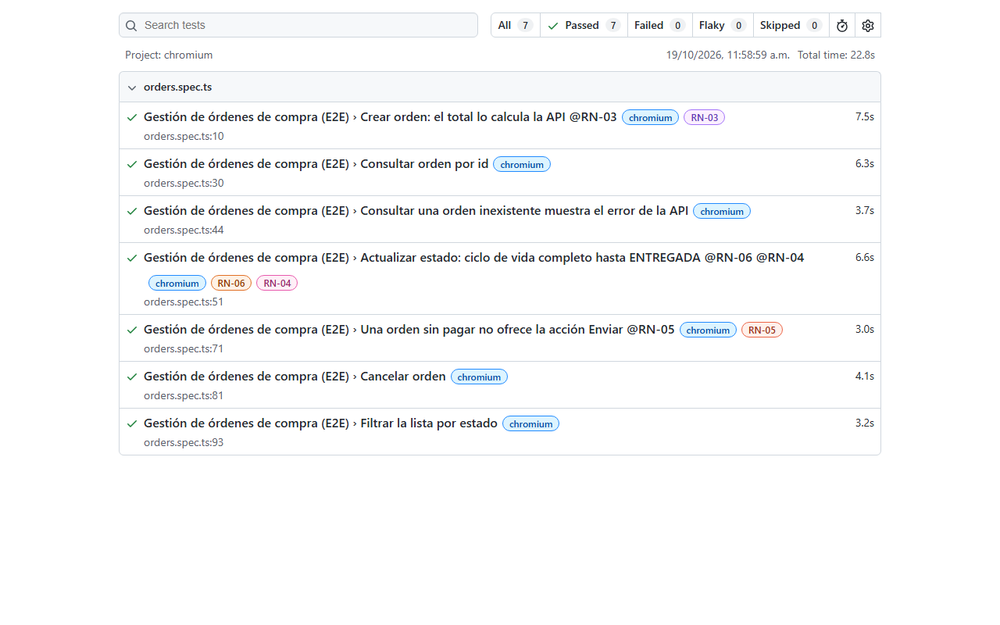
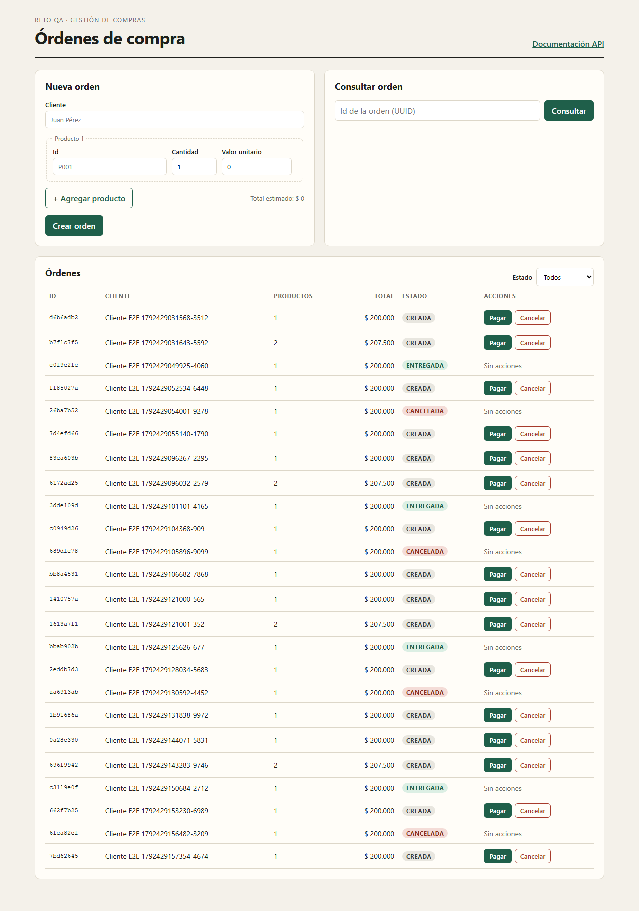
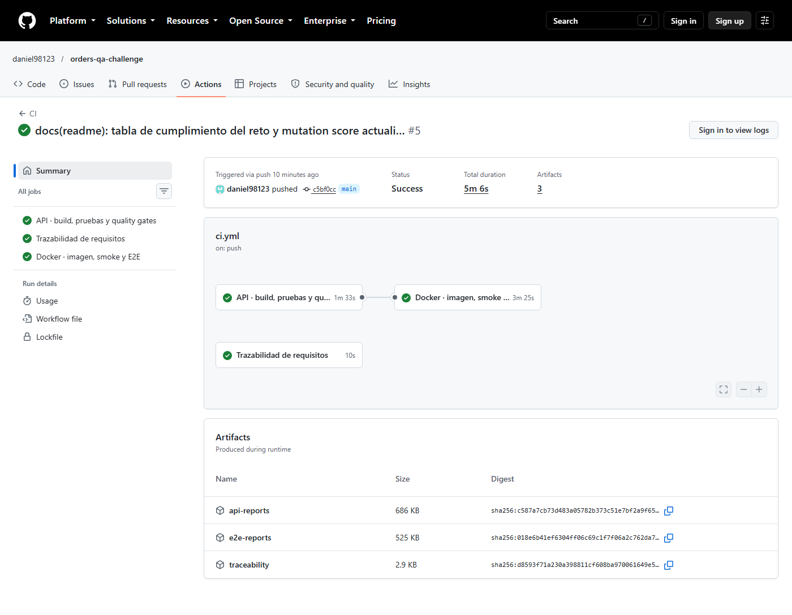

# Orders API · Reto Técnico QA Semi Senior

[](https://github.com/<usuario>/<repo>/actions/workflows/ci.yml)

API REST para la gestión de órdenes de compra con máquina de estados, construida con **calidad integrada en
cada etapa**: reglas de negocio trazables (RN-01…RN-06), pirámide de pruebas, quality gates automáticos
(cobertura, mutation testing, trazabilidad), contenedores, pipeline CI/CD, frontend con E2E y una herramienta
de trazabilidad asistida por IA.

| | |
|---|---|
| **Stack** | Java 17 · Spring Boot 3.5 · Maven |
| **Pruebas** | JUnit 5 · Mockito · AssertJ · MockMvc · Karate · Playwright |
| **Calidad** | JaCoCo (≥ 80 % líneas y ramas) · PIT (≥ 70 % mutation score) · matriz de trazabilidad |
| **Entrega** | Docker multi-stage · docker-compose · GitHub Actions |
| **Plus** | Frontend React + TypeScript · E2E Playwright · Plus IA (trazabilidad, escenarios faltantes, skill para IA) |

---

## Contenido

1. [Descripción de la solución](#1-descripción-de-la-solución)
2. [Arquitectura](#2-arquitectura)
3. [Decisiones técnicas](#3-decisiones-técnicas)
4. [Cómo ejecutar la aplicación](#4-cómo-ejecutar-la-aplicación)
5. [Uso de la API](#5-uso-de-la-api)
6. [Cómo ejecutar las pruebas](#6-cómo-ejecutar-las-pruebas)
7. [Pipeline CI/CD y quality gates](#7-pipeline-cicd-y-quality-gates)
8. [Evidencias](#8-evidencias)
9. [Plus de innovación: IA aplicada a la calidad](#9-plus-de-innovación-ia-aplicada-a-la-calidad)
10. [Versionamiento](#10-versionamiento)
11. [Estructura del repositorio](#11-estructura-del-repositorio)

---

## 1. Descripción de la solución

La API permite crear, consultar, listar, cambiar de estado y cancelar órdenes de compra.

**Máquina de estados** (única fuente de verdad: `OrderStatus.java`):



**Reglas de negocio y su comportamiento:**

| Regla | Comportamiento | HTTP | `code` en la respuesta |
|---|---|---|---|
| RN-01 | La orden debe tener al menos un producto | 400 | `VALIDATION` (mensaje con `RN-01`) |
| RN-02 | Cantidad de cada producto > 0 | 400 | `VALIDATION` (mensaje con `RN-02`) |
| RN-03 | El total lo calcula el servidor; `total`/`estado` enviados por el cliente se ignoran | 201 | — |
| RN-04 | Una orden ENTREGADA no se puede cancelar | 409 | `RN-04` |
| RN-05 | No se puede ENVIAR una orden no PAGADA | 400 | `RN-05` |
| RN-06 | Cualquier otra transición inválida se rechaza | 409 | `RN-06` |

Todos los errores siguen **RFC 7807** (`application/problem+json`) e incluyen `code`, `correlationId` y `timestamp`:

```json
{
  "type": "about:blank",
  "title": "Orden no pagada",
  "status": 400,
  "detail": "La orden no puede ser enviada porque no ha sido pagada",
  "instance": "/orders/5b1e.../status",
  "code": "RN-05",
  "correlationId": "c0a8012e-...",
  "timestamp": "2026-10-19T15:30:00Z"
}
```

## 2. Arquitectura

Arquitectura **hexagonal (puertos y adaptadores)** en un único servicio:



| Capa | Paquete | Responsabilidad |
|---|---|---|
| Dominio | `domain` | Reglas de negocio puras (sin Spring). `Order` es **inmutable**: cada transición crea una nueva instancia. |
| Aplicación | `application` | Casos de uso y puerto `OrderRepository`. |
| Infraestructura | `infrastructure.web` | REST, DTOs, validación, manejo de errores, observabilidad. |
| Infraestructura | `infrastructure.persistence` | Adaptador en memoria con actualización atómica (`computeIfPresent`). |

**Observabilidad:** header `X-Correlation-Id` (se recibe o se genera), presente en cada línea de log y en
cada error; log de acceso con método, ruta, estado y duración; eventos de negocio
(`event=order_created`, `event=order_status_changed`, `event=business_rule_violation`);
`/actuator/health` (usado por los healthchecks de Docker); OpenAPI en `/swagger-ui.html`.

## 3. Decisiones técnicas

| Decisión | Por qué |
|---|---|
| Java 17 + Spring Boot 3.5 | Stack sugerido; Karate y PIT se integran nativamente con Maven. |
| Dominio sin dependencias de Spring | Las reglas se prueban con pruebas unitarias rápidas y son el objetivo principal de PIT. |
| Validación en dos niveles (Bean Validation + dominio) | Errores de contrato claros en la API y reglas garantizadas aunque cambie el punto de entrada. |
| Agregado inmutable + `computeIfPresent` | Evita *lost updates* con peticiones concurrentes (probado con 32 hilos). |
| Persistencia en memoria detrás de un puerto | El reto no exige BD; reemplazarla es un adaptador nuevo. |
| RFC 7807 + `code` de regla | Errores estándar y trazables desde la respuesta hasta el requisito. |
| `DELETE` = cancelación lógica (200 + cuerpo) | Las órdenes no se borran (auditoría). |
| Cobertura medida solo con unit/componente | El gate no se infla con pruebas de alto nivel. |
| Karate en Failsafe con puerto aleatorio o `-Dkarate.baseUrl` | El mismo set corre local, en CI y contra el contenedor. |

Las ambigüedades del enunciado (cancelar ENVIADA, 400 vs 409, doble cancelación, etc.) y el análisis de
riesgo completo están en **[docs/TEST_STRATEGY.md](docs/TEST_STRATEGY.md)**.

## 4. Cómo ejecutar la aplicación

### Paso 1 · Instalar los requisitos

| Herramienta | Versión | Para qué | Verificar con |
|---|---|---|---|
| Git | cualquiera | Clonar el repositorio | `git --version` |
| Java (JDK) | 17 o superior | Compilar y probar la API | `java -version` |
| Maven | 3.9 o superior | Build, pruebas, cobertura, PIT, Karate | `mvn -v` |
| Docker Desktop | con Compose v2 | Contenedores de la API y el frontend | `docker compose version` |
| Node.js | 22 o superior | Frontend y pruebas E2E | `node -v` |
| Python | 3.11 o superior | Herramienta de trazabilidad (plus IA) | `python --version` |

> **Windows:** con `winget` se instalan en un paso:
> `winget install EclipseAdoptium.Temurin.17.JDK OpenJS.NodeJS.22 Python.Python.3.12 Docker.DockerDesktop`.
> Maven no está en winget: descarga el zip de <https://maven.apache.org/download.cgi>, descomprímelo y agrega
> su carpeta `bin` al `PATH`. Docker Desktop necesita WSL 2 (`wsl --install` como administrador y reiniciar).
> Abre una **terminal nueva** después de instalar para que cargue el `PATH`.

Solo para levantar la aplicación basta con **Docker**; el resto se necesita para ejecutar las pruebas.

### Paso 2 · Clonar el repositorio

```bash
git clone https://github.com/<usuario>/<repo>.git
cd <repo>
```

### Paso 3 · Levantar la aplicación

**Opción A · Docker Compose (recomendada): API + frontend**

```bash
docker compose up -d --build --wait
docker compose ps        # ambos contenedores deben aparecer como "healthy"
```

La primera vez tarda unos minutos (descarga imágenes y dependencias). Para detenerlo: `docker compose down`.

**Opción B · Solo la API con Docker** (igual al ejemplo del reto)

```bash
docker build -t challenge-api .
docker run -p 8080:8080 challenge-api
```

**Opción C · Sin Docker**

```bash
# Terminal 1: API
mvn spring-boot:run

# Terminal 2: frontend en modo desarrollo (proxy /api -> http://localhost:8080)
cd frontend
npm install
npm run dev
```

### Paso 4 · Verificar que funciona

| URL | Qué debes ver |
|---|---|
| http://localhost:8080/actuator/health | `{"status":"UP",...}` |
| http://localhost:8080/swagger-ui.html | Documentación interactiva (OpenAPI) para probar los endpoints |
| http://localhost:3000 | Frontend (opción A) · en la opción C es http://localhost:5173 |

En el frontend puedes crear una orden, consultarla por id, avanzar su estado (Pagar → Enviar → Entregar),
cancelarla y filtrar la lista por estado.

## 5. Uso de la API

| Método | Ruta | Descripción | Éxito | Errores |
|---|---|---|---|---|
| `POST` | `/orders` | Crear orden | 201 + `Location` | 400 |
| `GET` | `/orders/{id}` | Consultar orden | 200 | 400 (id no UUID), 404 |
| `GET` | `/orders?estado=PAGADA` | Listar (filtro opcional) | 200 | 400 (estado inválido) |
| `PATCH` | `/orders/{id}/status` | Cambiar estado | 200 | 400 (RN-05, estado inválido), 404, 409 (RN-04, RN-06) |
| `DELETE` | `/orders/{id}` | Cancelar orden | 200 | 404, 409 (RN-04, RN-06) |

```bash
# Crear
curl -s -X POST localhost:8080/orders -H 'Content-Type: application/json' \
  -d '{"cliente":"Juan Pérez","productos":[{"id":"P001","cantidad":2,"valorUnitario":100000}]}'

# Pagar
curl -s -X PATCH localhost:8080/orders/{id}/status -H 'Content-Type: application/json' -d '{"estado":"PAGADA"}'

# Cancelar
curl -s -X DELETE localhost:8080/orders/{id}
```

Respuesta (el modelo del enunciado + fechas y `transicionesPermitidas`, que el frontend usa para mostrar
solo acciones válidas):

```json
{
  "id": "0d6f5f9c-8f0e-4f7b-9a43-3b8c0f7d2a11",
  "cliente": "Juan Pérez",
  "productos": [{ "id": "P001", "cantidad": 2, "valorUnitario": 100000 }],
  "total": 200000,
  "estado": "CREADA",
  "transicionesPermitidas": ["PAGADA", "CANCELADA"],
  "fechaCreacion": "2026-10-19T15:30:00Z",
  "fechaActualizacion": "2026-10-19T15:30:00Z"
}
```

## 6. Cómo ejecutar las pruebas

Ejecuta los pasos en orden desde la raíz del repositorio. Es la misma secuencia que corre el pipeline;
cada paso falla (`BUILD FAILURE` o código de salida ≠ 0) si no se cumple su quality gate.

### Paso 1 · Unitarias, componente y cobertura (JaCoCo)

```bash
mvn test
```

- **Resultado esperado:** `Tests run: 130, Failures: 0`, `All coverage checks have been met.` y `BUILD SUCCESS`.
- **Gate:** falla si la cobertura de líneas o de ramas es < 80 %.
- **Reporte:** `target/site/jacoco/index.html`.

### Paso 2 · Pruebas de aceptación con Karate

```bash
mvn verify
```

- Incluye el paso 1 y luego levanta la API en un puerto aleatorio y ejecuta los 29 escenarios Karate
  (no necesitas tener la aplicación corriendo).
- **Resultado esperado:** `scenarios: 29 | passed: 29 | failed: 0` y `BUILD SUCCESS`.
- **Reporte:** `target/karate-reports/karate-summary.html`.
- Solo los 4 escenarios obligatorios: `mvn verify "-Dkarate.options=--tags @obligatorio"`.

### Paso 3 · Mutation testing (PIT)

```bash
mvn test-compile org.pitest:pitest-maven:mutationCoverage
```

- **Resultado esperado:** `Generated 88 mutations Killed 85 (97%)` y `BUILD SUCCESS` (tarda 1–2 minutos).
- **Gate:** falla si el mutation score es < 70 %.
- **Reporte:** `target/pit-reports/index.html`.

### Paso 4 · Docker y smoke Karate contra el contenedor

```bash
docker compose up -d --build --wait
mvn test-compile failsafe:integration-test failsafe:verify "-Dkarate.baseUrl=http://localhost:8080" "-Dkarate.options=--tags @smoke"
```

- **Resultado esperado:** `orders-api` y `orders-web` en estado `healthy` y `scenarios: 3 | passed: 3`.
- Las comillas en los `-D...` son necesarias en PowerShell; en bash también funcionan.

### Paso 5 · E2E con Playwright (requiere el paso 4 en ejecución)

```bash
cd e2e
npm install
npx playwright install chromium
npx playwright test
npx playwright show-report      # abre el reporte HTML
cd ..
```

- **Resultado esperado:** `7 passed`.
- Por defecto apunta a http://localhost:3000. Para otro ambiente: variable `E2E_BASE_URL`
  (bash: `E2E_BASE_URL=http://localhost:5173 npx playwright test` · PowerShell:
  `$env:E2E_BASE_URL='http://localhost:5173'; npx playwright test`).

### Paso 6 · Trazabilidad de requisitos (plus IA)

```bash
python -m unittest discover -s ai-tools/traceability/tests
python ai-tools/traceability/traceability.py --out target/traceability --fail-on-gaps
```

- **Resultado esperado:** `Ran 9 tests ... OK` y la matriz generada sin brechas en las reglas (código de salida 0).
- **Gate:** falla si alguna regla RN-01…RN-06 no tiene pruebas en las capas requeridas.
- **Reporte:** `target/traceability/traceability.md` (también `missing-scenarios.feature` con los esqueletos Karate).
- En macOS/Linux usa `python3` si `python` no existe.

### Paso 7 · Apagar el entorno

```bash
docker compose down
```

### Resumen de comandos

| Qué | Comando | Reporte |
|---|---|---|
| Unitarias + componente + **gate de cobertura** | `mvn test` | `target/site/jacoco/index.html` |
| Todo lo anterior + **Karate** | `mvn verify` | `target/karate-reports/karate-summary.html` |
| **Mutation testing** (gate ≥ 70 %) | `mvn test-compile org.pitest:pitest-maven:mutationCoverage` | `target/pit-reports/index.html` |
| Karate contra un ambiente desplegado | `mvn test-compile failsafe:integration-test failsafe:verify "-Dkarate.baseUrl=http://localhost:8080"` | ídem |
| **E2E Playwright** (requiere `docker compose up -d --build`) | `cd e2e && npm install && npx playwright install chromium && npx playwright test` | `e2e/playwright-report/index.html` |
| **Trazabilidad** (gate) | `python ai-tools/traceability/traceability.py --fail-on-gaps` | `target/traceability/traceability.md` |
| Pruebas de la herramienta de trazabilidad | `python -m unittest discover -s ai-tools/traceability/tests` | consola |

### Problemas frecuentes

| Síntoma | Solución |
|---|---|
| `Port 8080 is already in use` / el contenedor no arranca | Detén lo que use el puerto (otra instancia de la API o `docker compose down`) |
| `docker: command not found` o error 500 del motor | Abre Docker Desktop y espera a que diga *Engine running*; en Windows verifica WSL 2 con `wsl --status` |
| `mvn`/`java` no se reconocen | Abre una terminal nueva tras instalar; revisa `JAVA_HOME` y que `bin` de Maven esté en el `PATH` |
| Un E2E falla por timeout justo después de levantar los contenedores | La JVM arranca en frío; ejecuta el smoke del paso 4 primero (calienta la API) y reintenta |
| `python` abre la Microsoft Store (Windows) | Instala Python 3.12 y desactiva el alias en *Configuración → Aplicaciones → Alias de ejecución* |

**Escenarios Karate** (`src/test/resources/karate/orders`):

- `orders-obligatorios.feature`: los 4 exigidos (`@obligatorio`): crear (201), consultar (200),
  enviar sin pagar (400 y el estado no cambia), cancelar entregada (409 y el estado no cambia).
- `orders-adicionales.feature`: 25 escenarios adicionales, cada uno con el **riesgo que mitiga** comentado
  sobre el escenario: total manipulado por el cliente, órdenes inválidas, ciclo de vida completo, 11
  transiciones inválidas priorizadas, cancelación desde cada estado no final, doble cancelación, 404/400,
  listado con filtro y propagación del correlation id.

**Pirámide** (detalle en [docs/TEST_STRATEGY.md](docs/TEST_STRATEGY.md#3-pirámide-de-pruebas)):
≈ 100 ejecuciones unitarias · 28 de componente HTTP · 29 escenarios Karate · 7 flujos E2E.

## 7. Pipeline CI/CD y quality gates

`.github/workflows/ci.yml` (push a `main`/`develop`, pull requests y ejecución manual):



| Job | Pasos | Falla si |
|---|---|---|
| `api-quality` | Checkout → Build → Unit + JaCoCo → PIT → Karate → resumen de gates → artifacts | Prueba fallida, cobertura < 80 % (líneas o ramas), mutation score < 70 % |
| `traceability` | Pruebas de la herramienta → matriz → resumen | Alguna RN sin pruebas en sus capas requeridas |
| `docker-e2e` | `docker build` → `docker compose up --wait` → smoke Karate contra el contenedor → Playwright → logs | Imagen no construye, healthcheck falla, smoke o E2E fallan |

Cada ejecución publica un **resumen de quality gates** en la página del job (generado por
`.github/scripts/quality_summary.py`, incluye los mutantes sobrevivientes) y los reportes como artifacts.
Sonar no se integró para no depender de un servicio externo; los mismos umbrales se aplican con JaCoCo/PIT.

## 8. Evidencias

Resultados de una ejecución completa. En [docs/evidence/README.md](docs/evidence/README.md) está cómo
regenerar cada captura; cada ejecución del pipeline publica además los reportes como artifacts
(`api-reports`, `traceability`, `e2e-reports`).

| Evidencia | Resultado | Gate |
|---|---|---|
| Cobertura (JaCoCo) | 100 % líneas · 95 % ramas | ≥ 80 % ✅ |
| Mutation testing (PIT) | 97 % (85/88 mutantes eliminados) | ≥ 70 % ✅ |
| Karate | 29/29 escenarios | 0 fallidos ✅ |
| E2E Playwright | 7/7 flujos | 0 fallidos ✅ |
| Trazabilidad | RN-01…RN-06 con pruebas en todas sus capas | sin brechas ✅ |

**Cobertura (JaCoCo)**



**Mutation testing (PIT)**



**Pruebas de aceptación (Karate)**



**E2E (Playwright)**



**Frontend**



**Pipeline (GitHub Actions)**



**Matriz de trazabilidad:** [docs/evidence/traceability.md](docs/evidence/traceability.md)

## 9. Plus de innovación: IA aplicada a la calidad

Detalle en [ai-tools/README.md](ai-tools/README.md).

- **Matriz de trazabilidad automática** (`ai-tools/traceability`): cruza las reglas de
  `docs/requirements.json` con las pruebas de las tres capas (tags `@RN-xx`), lee la máquina de estados
  **desde el código** y calcula la cobertura de las 25 transiciones. Corre en CI como quality gate.
- **Identificación de escenarios faltantes priorizados por riesgo** y **generación automática** de
  esqueletos Karate (`missing-scenarios.feature`). Resultado real: detectó 9 transiciones de prioridad ALTA
  sin prueba de aceptación; se cerraron y la cobertura de aceptación de la máquina de estados pasó de 11/25 a 20/25.
- **Recomendaciones con LLM** (`--suggest`, opcional): envía solo el resumen de brechas a Claude y guarda
  las propuestas como borrador para revisión humana.
- **Skill para asistentes de IA** (`.claude/skills/qa-test-designer`): procedimiento para que un asistente
  (p. ej. Claude Code) diseñe pruebas por riesgo y capa de la pirámide siguiendo las convenciones del repo.

**Uso responsable de IA en este proyecto:** la solución se desarrolló con asistencia de IA (Claude) como
herramienta de productividad; las decisiones de diseño, ambigüedades y umbrales están documentadas y
justificadas, todo el código pasa por los mismos quality gates que cualquier cambio, y ningún gate depende
de un LLM.

## 10. Versionamiento

- **Conventional Commits** (`feat:`, `test:`, `ci:`, `docs:`…), un commit por unidad lógica de trabajo.
- Flujo sugerido: `main` protegida + ramas `feature/*` → Pull Request con el pipeline en verde como condición de merge.
- Versionado semántico de la API (`1.0.0` en `pom.xml`).

## 11. Estructura del repositorio

```
.
├── src/main/java/com/reto/orders
│   ├── domain/                 # Order, OrderItem, OrderStatus, excepciones de negocio
│   ├── application/            # OrderService, puerto OrderRepository
│   ├── infrastructure/web/     # Controller, DTOs, errores RFC 7807, CorrelationIdFilter
│   ├── infrastructure/persistence/  # Repositorio en memoria
│   └── config/
├── src/test/java/...           # Unit, componente (@WebMvcTest), smoke, runner Karate (*IT)
├── src/test/resources/karate/  # Features Karate, datos y esquemas
├── frontend/                   # React + TypeScript + Vite (Dockerfile + nginx)
├── e2e/                        # Playwright
├── ai-tools/traceability/      # Matriz de trazabilidad + pruebas
├── .claude/skills/             # Skill de diseño de pruebas para asistentes de IA
├── docs/                       # Estrategia de pruebas, requisitos, evidencias
├── .github/workflows/ci.yml    # Pipeline
├── Dockerfile · docker-compose.yml
└── pom.xml
```
